# CK SYS V3 — Complete User Manual

**System:** CK SYS V3  
**Companies:** CK Plastics and AR Plastics  
**Manual edition:** 1.0  
**Reviewed against source:** 24 October 2026  
**Audience:** owners, administrators, production staff, inventory reviewers, sales staff, payroll staff, accountants, auditors, and read-only users

> **Screenshot note:** The screenshots in this manual were captured from the real CK SYS V3 React interface using isolated documentation data. Names, email addresses, references, quantities, and values shown in screenshots are examples; they are not production records.

---

## Contents

1. [What the system does](#1-what-the-system-does)
2. [End-to-end business flow](#2-end-to-end-business-flow)
3. [Access, companies, and permissions](#3-access-companies-and-permissions)
4. [Signing in](#4-signing-in)
5. [Navigation and common controls](#5-navigation-and-common-controls)
6. [First-time administrator setup](#6-first-time-administrator-setup)
7. [Dashboard](#7-dashboard)
8. [Production and conversion](#8-production-and-conversion)
9. [Inventory](#9-inventory)
10. [Sales and receivables](#10-sales-and-receivables)
11. [Staff and payroll](#11-staff-and-payroll)
12. [Accounting](#12-accounting)
13. [Activity and audit](#13-activity-and-audit)
14. [Account and password security](#14-account-and-password-security)
15. [System settings and administration](#15-system-settings-and-administration)
16. [Corrections and reversals](#16-corrections-and-reversals)
17. [Daily, weekly, monthly, and year-end routines](#17-daily-weekly-monthly-and-year-end-routines)
18. [Validation rules and error recovery](#18-validation-rules-and-error-recovery)
19. [Security and data-handling rules](#19-security-and-data-handling-rules)
20. [Troubleshooting](#20-troubleshooting)
21. [System verification report](#21-system-verification-report)
22. [Quick-reference checklists](#22-quick-reference-checklists)
23. [Glossary](#23-glossary)

---

## 1. What the system does

CK SYS V3 is a multi-company manufacturing, stock, sales, payroll, and accounting system. It replaces the earlier spreadsheet/Google Apps Script process with a React user interface, a same-origin Node.js Vercel API, Supabase Authentication, and transactional PostgreSQL operations.

The system provides:

- separate CK Plastics and AR Plastics portals;
- permission-controlled workspaces and actions;
- raw-material purchasing;
- bulk-material to chip conversion;
- worker piecework earnings during conversion;
- chip-to-finished-product production;
- company-owned and shared-warehouse inventory views;
- sales invoices, partial receipts, balances, and weighted COGS;
- employee records, daily work, overtime, payroll, deductions, contributions, and payments;
- automatic and manual double-entry accounting;
- financial, inventory, sales, payroll, and audit reports;
- traceable corrections and reversals;
- an append-only activity trail; and
- administrator-controlled user access and company data reset.

### 1.1 Important system principles

1. **Choose the correct company first.** CK and AR accounting and operational records are separated.
2. **Use the operational workflow that matches the event.** For example, create a sales invoice in Sales, not as a manual journal.
3. **Do not edit posted financial history silently.** Use the available correction or reversal action.
4. **Check the fiscal year before reviewing reports or posting accounting entries.**
5. **Treat all delete/reset controls as high risk.** Export, back up, verify the company, and obtain authorization first.
6. **Never share an account.** Each person should use an individual Supabase Authentication identity.

---

## 2. End-to-end business flow

The normal operating sequence is:

```text
Administrator setup
      ↓
Raw-material purchase
      ↓
Bulk stock increases + accounting entry
      ↓
Bulk-to-chip conversion + worker piecework accruals
      ↓
Chip stock increases / bulk stock decreases
      ↓
Production run
      ↓
Finished stock increases / chip stock decreases
      ↓
Sales invoice
      ↓
Finished stock decreases + revenue + COGS + receivable/cash
      ↓
Customer receipts
      ↓
Employee work and overtime → payroll → payroll payment
      ↓
Accounting reconciliation, reports, and audit review
```

### 2.1 Recommended first-use order

1. A group super administrator creates individual user accounts.
2. The administrator assigns CK, AR, or both companies and the minimum required capability packages.
3. In **Settings**, configure conversion types and piecework rates.
4. In **Staff & payroll**, create employee records and pay terms.
5. In **Production**, post purchases, conversions, and production runs.
6. In **Inventory**, verify the result after each material movement.
7. In **Sales**, invoice only available finished stock and record only money actually received.
8. In **Staff & payroll**, settle open work and overtime through payroll.
9. In **Accounting**, reconcile the automatic journals, ledger, and reports.
10. In **Activity & audit**, review sensitive or unexpected events.

---

## 3. Access, companies, and permissions

### 3.1 Company separation

- **CK portal:** paths start with `/ck/`.
- **AR portal:** paths start with `/ar/`.
- The portal determines the active company for every API request.
- Accounting and workforce data are company-scoped.
- The inventory screen distinguishes company-owned stock from shared physical warehouse availability.
- Having access to CK does not automatically grant AR access.

### 3.2 Capability packages

| Package | Intended access |
|---|---|
| Accounting & PDF Studio | Accounting, financial reports, PDF Studio, settlements, and payroll review |
| Production & operations | Purchases, conversion, production, inventory, sales, and operational reports |
| Staff & payroll | Employee records, daily work, overtime, payroll processing, and payroll reports |
| Read only | View operational and financial pages without posting or editing |
| Group super administrator | Full CK and AR administration, including creating other super administrators |

The menu hides unassigned workspaces. This is a usability feature, not the only security control: Node API authorization and PostgreSQL row-level security enforce access again on the server and database.

### 3.3 Account status

- **Active:** the person can sign in and use assigned capabilities.
- **Inactive:** access is rejected even if an older browser session still exists.
- The signed-in administrator cannot deactivate or remove their own account.
- The last active group super administrator cannot be deactivated or removed.
- Removing access preserves the underlying authentication identity and historical audit attribution.

---

## 4. Signing in

### 4.1 Select a company portal

1. Open the base application URL.
2. Select **CK Plastics login** or **AR Plastics login**.
3. Confirm that the company name in the login page matches the records you intend to use.

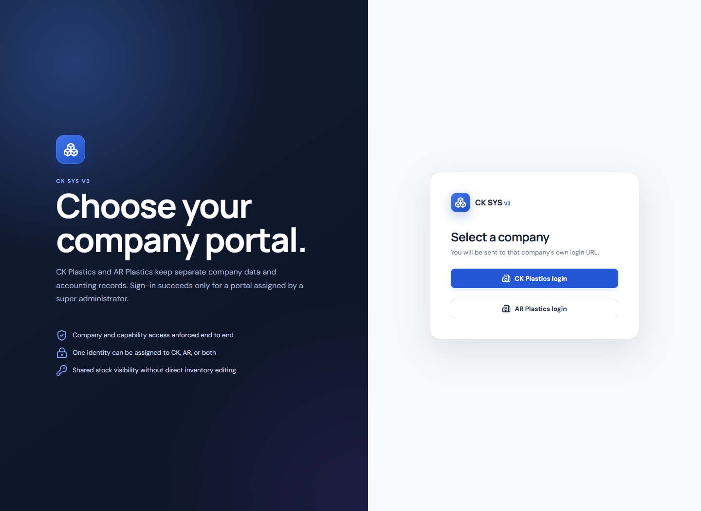

### 4.2 Sign in with email and password

1. Enter the individual account email.
2. Enter the password.
3. Select **Sign in securely**.
4. After sign-in, confirm the company name in the left sidebar and top bar.

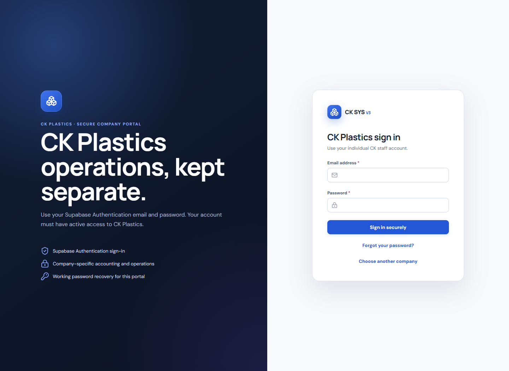

If sign-in fails:

- verify the email and password;
- verify that the correct company portal was selected;
- ask an administrator to confirm that the profile and company membership are active; and
- do not repeatedly guess a password—use recovery instead.

### 4.3 Recover a forgotten password

1. On the company login page, select **Forgot your password?**
2. Enter the registered email.
3. Select **Send OTP PIN**.
4. Check the email inbox and spam folder.
5. If a six-digit PIN is provided, enter it and select **Verify PIN**.
6. If the provider sends a secure recovery link, open that link in the same company portal.
7. Enter a new password twice.
8. The password must have at least 10 characters, one lowercase letter, one uppercase letter, one number, and one symbol.
9. If requested, sign in again with the new password.

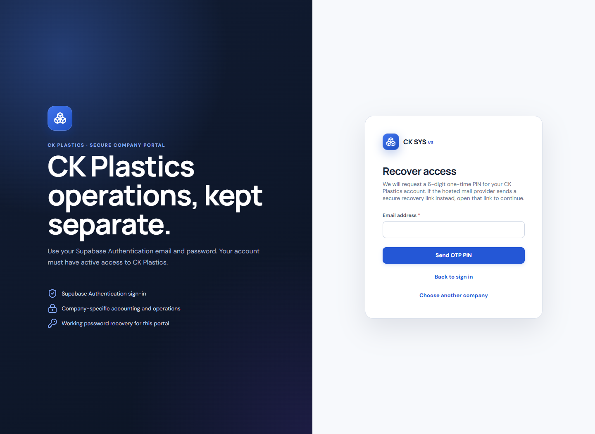

Hosted six-digit PIN delivery depends on custom SMTP and the configured Supabase recovery template. If the mail provider supplies a link instead, the link follows the same secure reset flow.

### 4.4 Sign out

Select the sign-out icon beside the user profile at the bottom of the sidebar. Sign-out ends the current browser/device session only; it does not automatically sign out other devices.

---

## 5. Navigation and common controls

### 5.1 Main layout

- **Left sidebar:** module navigation, company identity, connection state, signed-in identity, and sign-out.
- **Top bar:** current page, company, fiscal year, API state, and Refresh.
- **Fiscal year:** changes year-sensitive dashboard, sales, payroll, ledger, and report views.
- **Refresh:** reloads currently cached data from the API.
- **Live API / Offline badge:** shows browser connectivity. Confirm data loaded successfully before relying on a page.
- **Mobile menu:** opens the sidebar on narrow screens.
- **Bottom navigation:** provides module links on mobile.

### 5.2 Common statuses

| Status | Meaning |
|---|---|
| Posted | The record and its business effects are active |
| Reversed | An offsetting action removed the business effect while retaining history |
| Paid | No balance remains |
| Partially paid | Some amount is paid; a balance remains |
| Unpaid / Payable | The full amount remains due |
| Active | Available for new use |
| Inactive | Retained for history but not available for new selection |

### 5.3 Refresh and stale-data warnings

If a refresh fails while older data is on screen, the application may retain the last successfully loaded snapshot and show a warning. Do not use that snapshot for a financial or stock decision until Refresh succeeds.

---

## 6. First-time administrator setup

### 6.1 Create login accounts

1. Open **Settings** in CK or AR.
2. Under **Login accounts & access**, select **Create account**.
3. Enter the person's display name.
4. Enter the person's unique email.
5. Enter a strong temporary password.
6. Choose **CK**, **AR**, or **Both**.
7. Select only the capability packages required for the person's job.
8. Select **Group super administrator** only for an owner who must administer both systems.
9. Select **Create account**.
10. Ask the person to sign in and change the temporary password immediately.

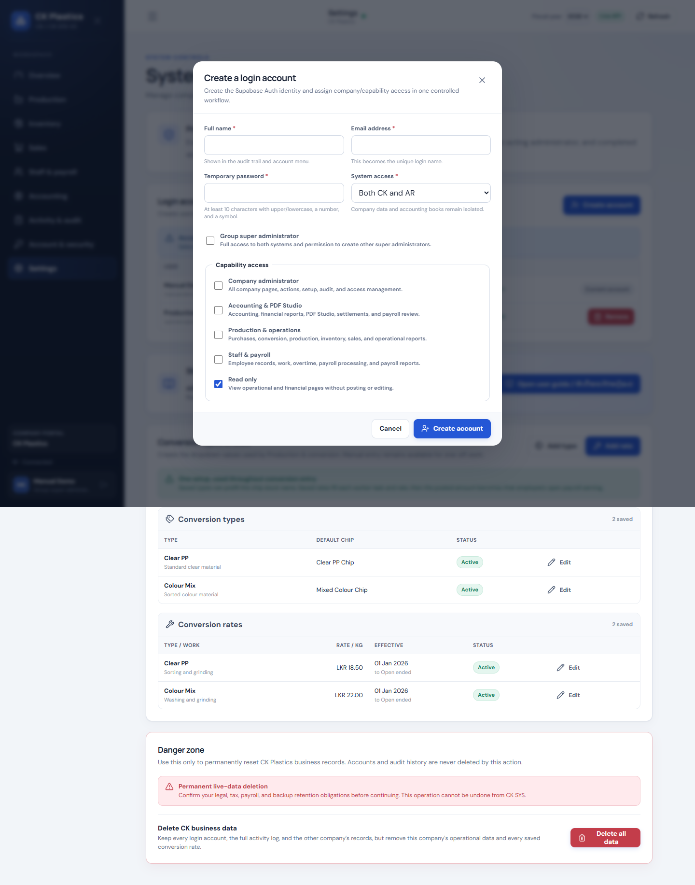

### 6.2 Configure conversion setup

1. Open **Settings**.
2. Under **Conversion types & rates**, select **Add type**.
3. Enter the conversion type and, if applicable, the default chip stock name.
4. Save the type.
5. Select **Add rate**.
6. Choose the related type, enter the work description and rate per kg, and enter the effective dates.
7. Save the rate.
8. Confirm that both entries appear as Active.

### 6.3 Create employees before worker allocation

Production conversions and production operators refer to employee records. Create the employee master and pay terms before entering worker allocations.

---

## 7. Dashboard

Open **Overview** after sign-in and at the beginning and end of each operating day.

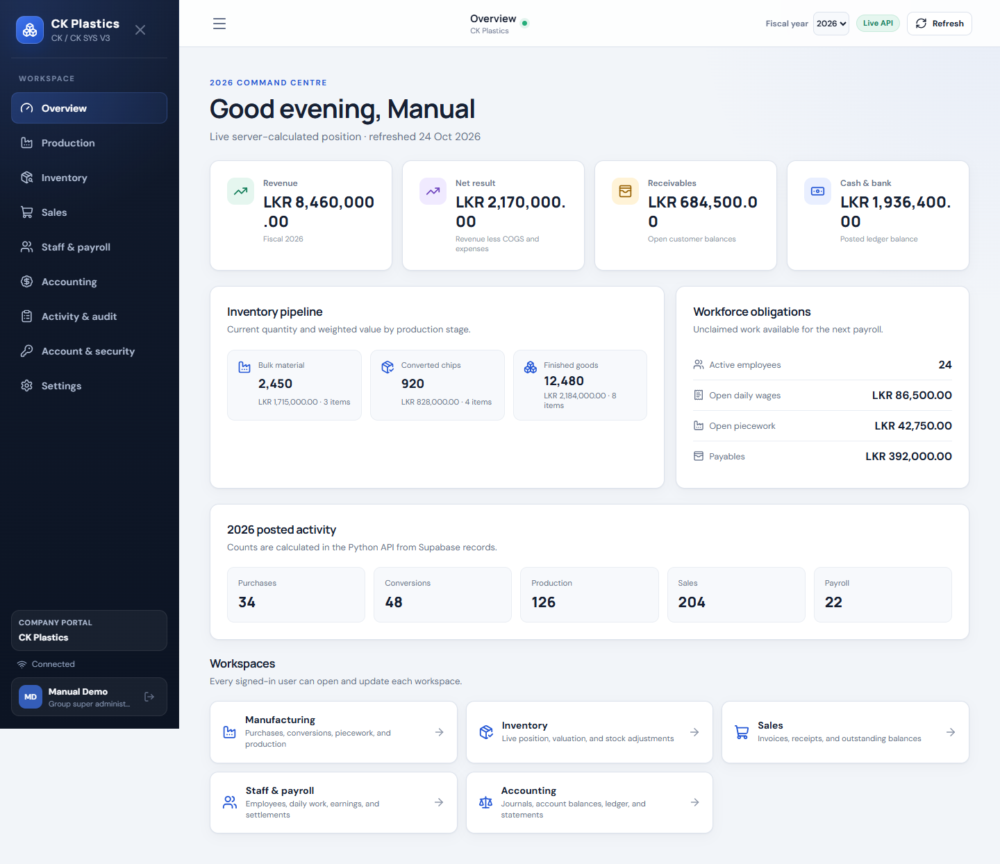

### 7.1 What to review

- **Revenue:** posted revenue in the selected fiscal year.
- **Net result:** revenue less COGS and expenses.
- **Receivables:** open customer balances.
- **Cash & bank:** posted ledger balance.
- **Inventory pipeline:** bulk, chip, and finished quantities and values.
- **Workforce obligations:** active employees, open daily wages, open piecework, and payables.
- **Posted activity:** counts of purchases, conversions, production, sales, and payroll.
- **Workspace cards:** direct links to operational modules.

### 7.2 Dashboard control procedure

1. Confirm the company in the sidebar.
2. Confirm the fiscal year.
3. Select **Refresh**.
4. Look for unexpected negative/zero values or sudden changes.
5. Compare stock stages with the day's physical activity.
6. Review receivables and payables.
7. Investigate differences through Inventory, Accounting, and Activity & audit.

---

## 8. Production and conversion

Open **Production**. The tabs are Dashboard, Bulk RM, Conversions, Rate master, and Production runs.

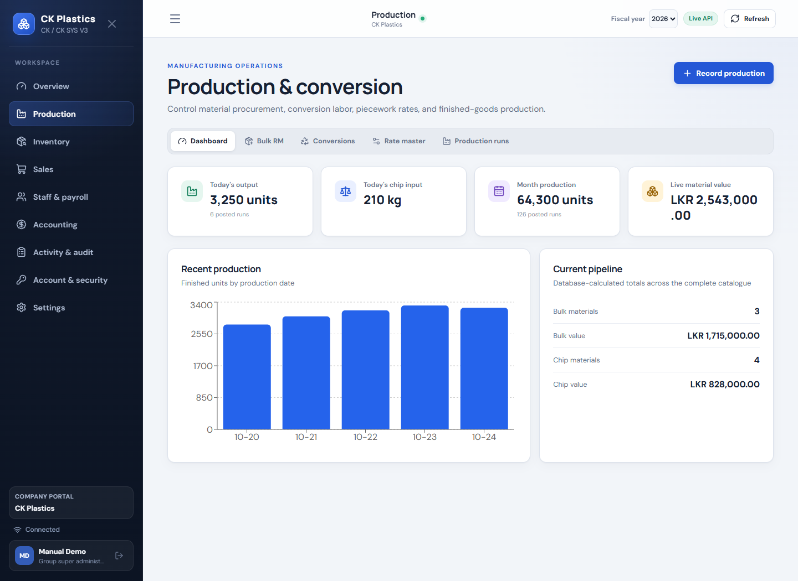

### 8.1 Production dashboard

Review today's output, today's chip input, monthly output, live bulk/chip value, recent production, and current pipeline counts. These values are calculated from server data.

### 8.2 Post a raw-material purchase

1. Open **Bulk RM**.
2. Select **New purchase**.
3. Enter the purchase date.
4. Select the payment method:
   - Accounts payable for a credit supplier purchase;
   - Cash;
   - Bank transfer; or
   - Cheque.
5. Enter the material name.
6. Enter quantity in kilograms.
7. Enter supplier name and phone when known.
8. Enter the total cost.
9. Enter useful notes or external references.
10. Select **Save purchase**.
11. Verify the new row in Bulk RM.
12. Open Inventory and confirm bulk quantity/value.
13. Open Accounting and confirm the related journal.

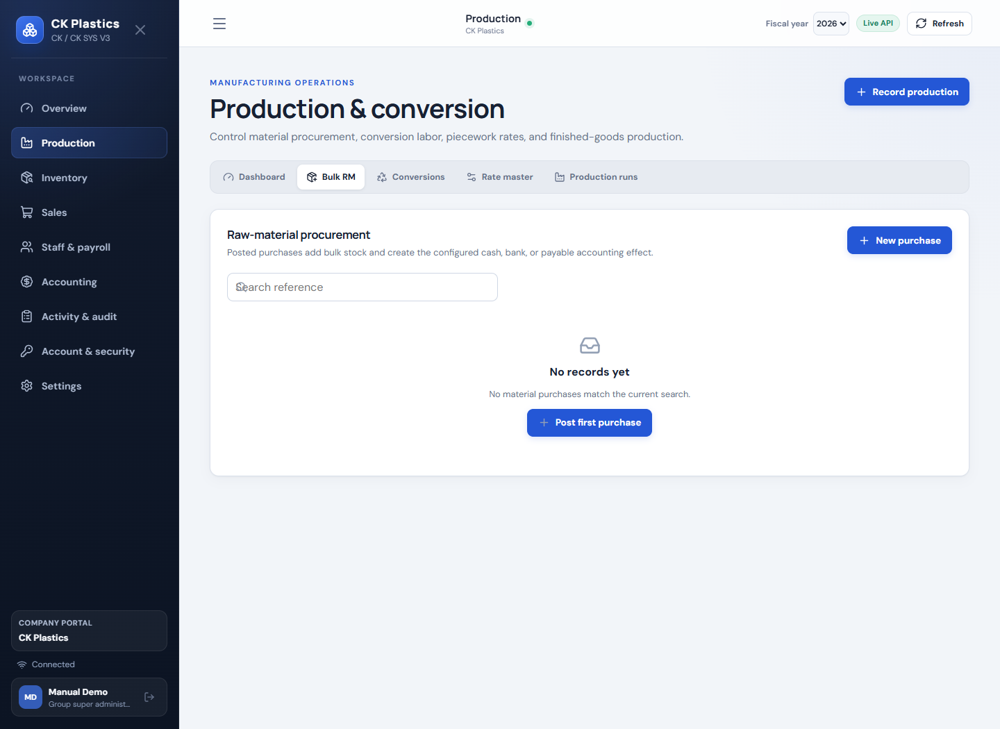

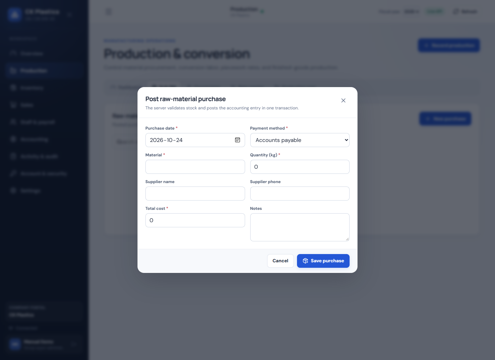

The server validates and posts stock and accounting in one transaction. A failed save should not leave only one side posted.

### 8.3 Post a bulk-to-chip conversion

1. Open **Conversions**.
2. Select **New conversion**.
3. Enter the conversion date.
4. Choose a saved conversion type or choose Manual.
5. Select the source bulk stock.
6. Enter input kg. Do not exceed available company stock.
7. Confirm or enter the chip stock name.
8. If Manual is selected, describe the conversion type.
9. Enter output kg. Output may not exceed input by more than 2%.
10. Enter conversion overhead when applicable.
11. Add at least one worker.
12. For each worker, select the employee, choose or enter the task, enter quantity, and enter the rate per kg.
13. Review each worker's calculated amount.
14. Select **Post conversion & earnings**.
15. Verify that bulk stock decreased and chip stock increased.
16. Verify each worker amount under **Staff & payroll → Open earnings**.

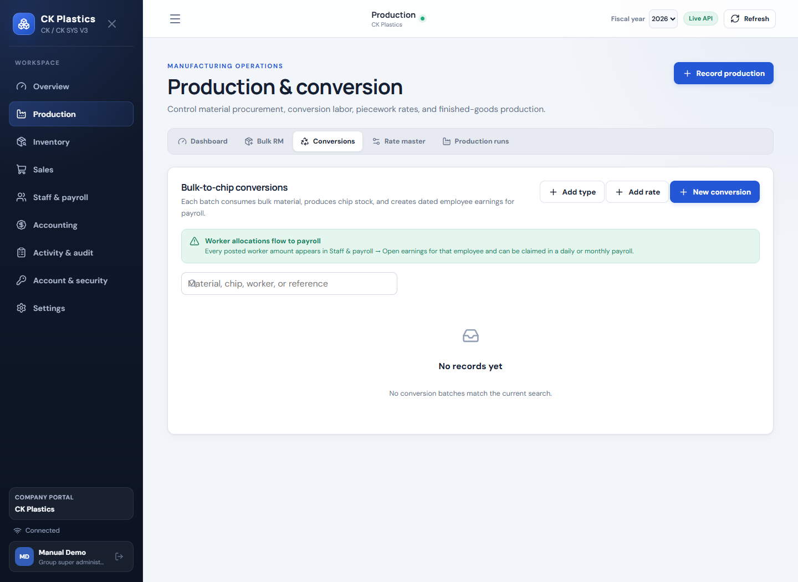

### 8.4 Maintain the rate master

Use **Rate master** for repeatable work types. Effective dates matter: the conversion date determines which saved rate is applicable. Editing a prefilled value during entry switches that value to a manual rate for the transaction.

### 8.5 Record a production run

1. Open **Production runs** or select **Record production**.
2. Enter the production date.
3. Enter shift and machine when used.
4. Select the employee/operator.
5. Enter working hours.
6. Select the chip input item.
7. Enter chip input kg, not exceeding available stock.
8. Select an existing finished product or enter a new finished-product name.
9. Enter the selling price. It becomes the product's default invoice price but remains editable on an invoice.
10. Enter output quantity.
11. Enter overhead cost and notes.
12. Review estimated material, overhead, total, and unit cost.
13. Select **Save production**.
14. Verify chip consumption and finished-stock output in Inventory.
15. Verify the production costing journal in Accounting.

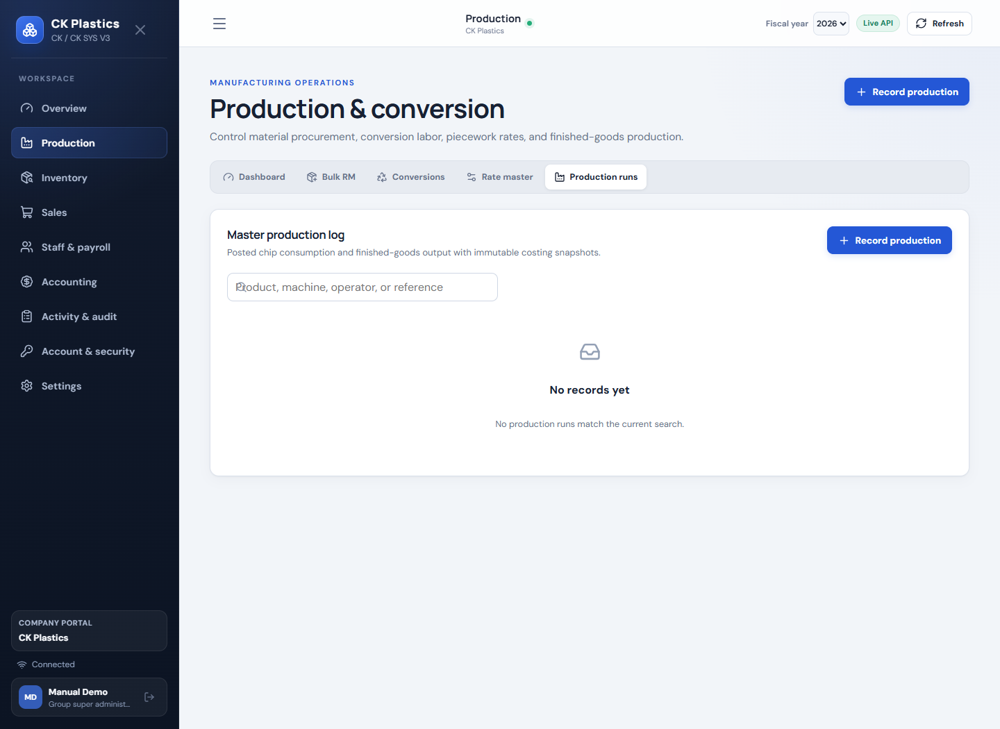

### 8.6 Production corrections

- **Edit/Correct:** releases the existing effects and reposts the corrected transaction atomically where supported.
- **Reverse:** retains the original row, marks it reversed, and posts offsetting stock/financial effects.
- Always enter the real correction date/value and record a clear reason.

---

## 9. Inventory

Inventory is intentionally read-only. Stock quantities change only through purchasing, conversion, production, and sales.

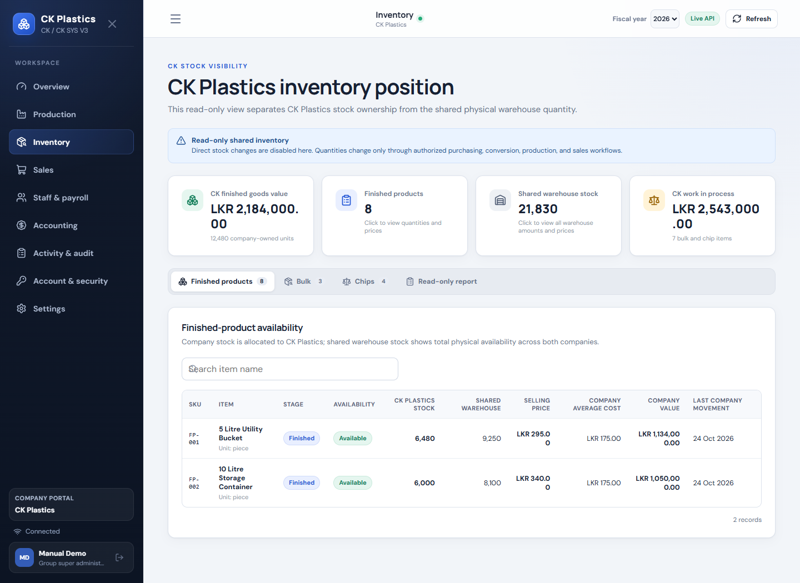

### 9.1 Summary cards

- company finished-goods value;
- number of finished products;
- shared physical warehouse stock; and
- company work-in-process value for bulk and chips.

### 9.2 Tabs

- **Finished products:** available finished goods, company quantity, shared quantity, selling price, weighted average cost, and value.
- **Bulk:** raw-material position.
- **Chips:** converted-material position.
- **Read-only report:** printable/searchable inventory report.

### 9.3 Company stock versus shared warehouse stock

- **Company stock** is the quantity owned/allocated to the current company.
- **Shared warehouse** is physical availability across permitted company stock.
- Sales and production must still pass server-side company and availability rules; visibility does not grant editing rights.

### 9.4 Inventory verification procedure

1. Refresh the page.
2. Select the relevant stage.
3. Search for the item.
4. Compare company quantity with the source transaction.
5. Check shared availability.
6. Review selling price for finished products.
7. Review average unit cost and company value.
8. Check the last company movement date.
9. Use the read-only report for printing or PDF export.

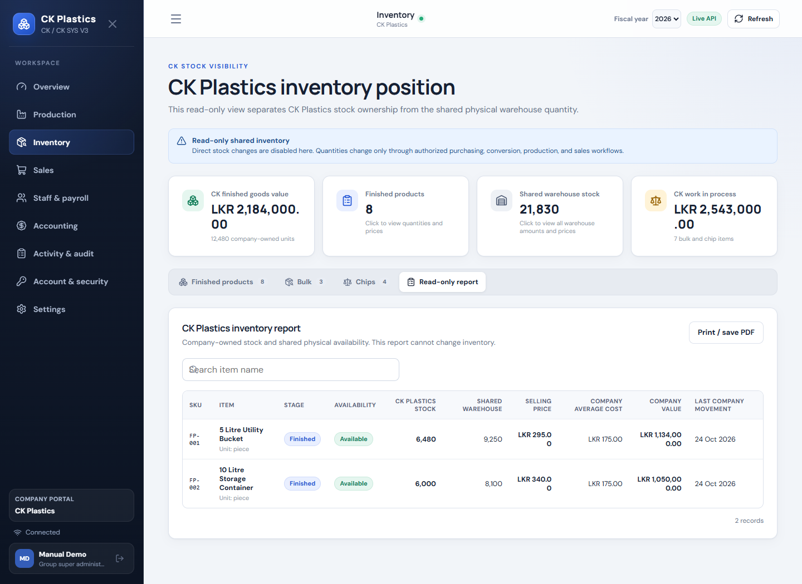

If a stock figure is wrong, correct or reverse the source transaction. Do not attempt a direct inventory edit.

---

## 10. Sales and receivables

Open **Sales**. The tabs are Invoices, Outstanding, and Sales report.

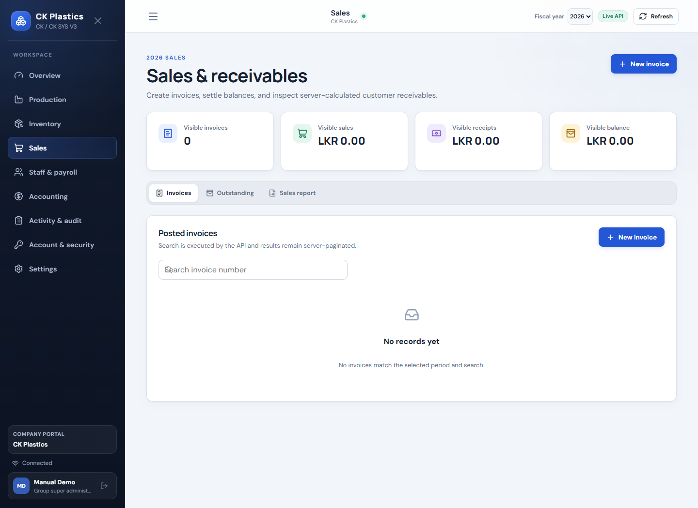

### 10.1 Create a sales invoice

1. Select **New invoice**.
2. Enter a unique invoice number.
3. Enter the sale date.
4. Enter customer name.
5. Enter a customer phone number if invoice sharing by WhatsApp may be required.
6. Select the initial payment method.
7. Enter the amount already received, or 0 for a fully outstanding invoice.
8. For each line:
   - select the finished product;
   - confirm available stock;
   - enter quantity;
   - review or change the unit price; and
   - enter an offer discount if applicable.
9. Use **Add line** for additional products.
10. Review the invoice total.
11. Select **Save invoice**.
12. Confirm the invoice, paid amount, due amount, and payment status in the table.
13. Verify finished-stock reduction and accounting entries.

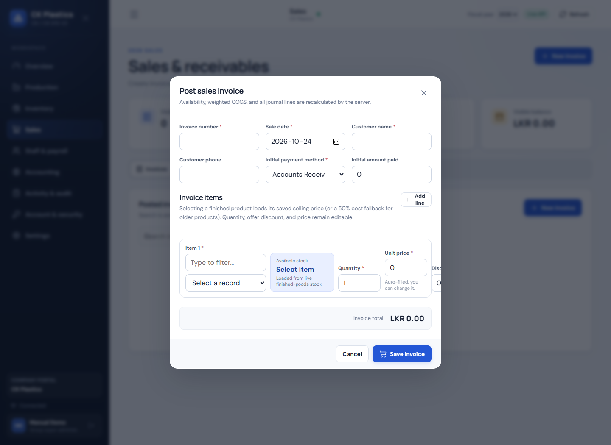

The server recalculates availability, weighted COGS, and journal lines. A browser-entered figure cannot override stock availability or server costing.

### 10.2 Record a receipt

1. Open the invoice's receipt/payment action.
2. Review the current balance.
3. Enter payment date.
4. Enter the amount. It must be positive and cannot exceed the remaining balance.
5. Choose the actual method; credit/accounts-receivable is not a receipt method.
6. Add notes or a bank/cheque reference.
7. Select **Post receipt**.
8. Confirm the updated paid and due amounts.
9. Confirm the receipt in Accounting.

### 10.3 Outstanding invoices

Use **Outstanding** to follow up unpaid and partially paid invoices. Search by invoice/customer and reconcile balances to the receivables account.


### 10.4 Invoice details and printing

Open invoice details to review lines and receipt history. The invoice view supports printing and PDF saving. WhatsApp sharing requires a valid customer phone number.

### 10.5 Reverse an invoice or receipt

- Reversing an invoice retains it and offsets stock, revenue, COGS, and related receipts according to server rules.
- Reversing a receipt retains the receipt and offsets its accounting effect.
- Use reversal for a posted transaction; do not create an unrelated negative invoice as a workaround.

---

## 11. Staff and payroll

Open **Staff & payroll**. The tabs are Employees, Daily work, OT hours, Open earnings, Payroll, and Payroll report.

### 11.1 Create an employee

1. Open **Employees**.
2. Select **New employee**.
3. Enter employee number and full name.
4. Enter NIC, phone, address, joined date, and other identity details.
5. Select or enter job role, employment type, and shift.
6. Enter EPF number and ETF reference when applicable.
7. Select Active status.
8. Choose the pay model:
   - Monthly salary;
   - Daily wage;
   - Hybrid (monthly plus work claims); or
   - Piecework.
9. Enter the applicable monthly rate, daily rate, OT rate, and effective date.
10. Review standard hours/days and statutory rates/defaults.
11. Enter bank, branch, account name, and account number when used.
12. Save the employee.


Deactivating an employee removes the person from active selections but preserves historical work and payroll.

### 11.2 Record daily work

1. Open **Daily work**.
2. Select **Record work**.
3. Select the employee.
4. Enter the work date.
5. Enter work units.
6. Review the daily rate loaded from the employee; the record saves its own rate snapshot.
7. Optionally add manual piecework lines with task, quantity kg, and rate per kg.
8. Add notes.
9. Save the record.
10. Verify the amount in **Open earnings**.

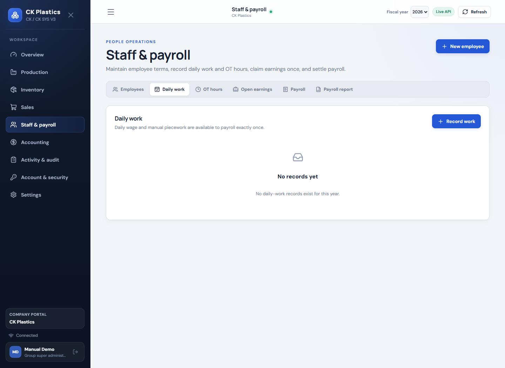

### 11.3 Record overtime

1. Open **OT hours** or an employee's **OT details**.
2. Select **Add OT hours**.
3. Select the employee if required.
4. Enter OT date.
5. Enter hours between 0.01 and 24, in supported increments.
6. Review or enter the OT rate.
7. Add a note.
8. Save and verify the calculated amount.

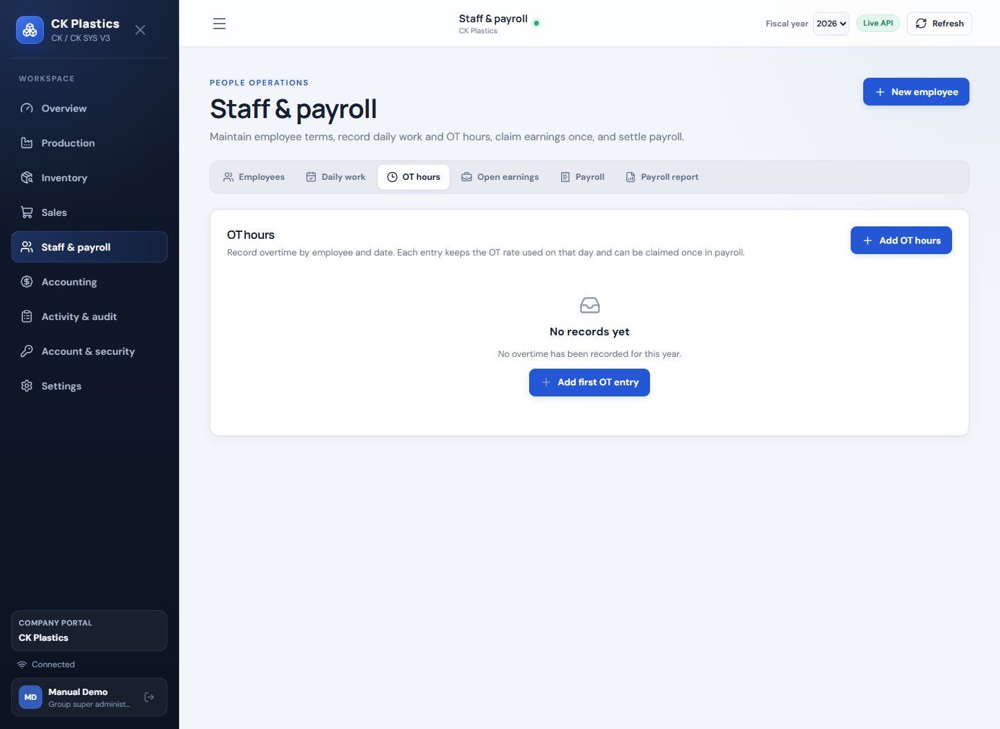

### 11.4 Review open earnings

Open earnings can include daily wages, manual piecework, conversion-worker earnings, and overtime that have not yet been claimed by payroll.

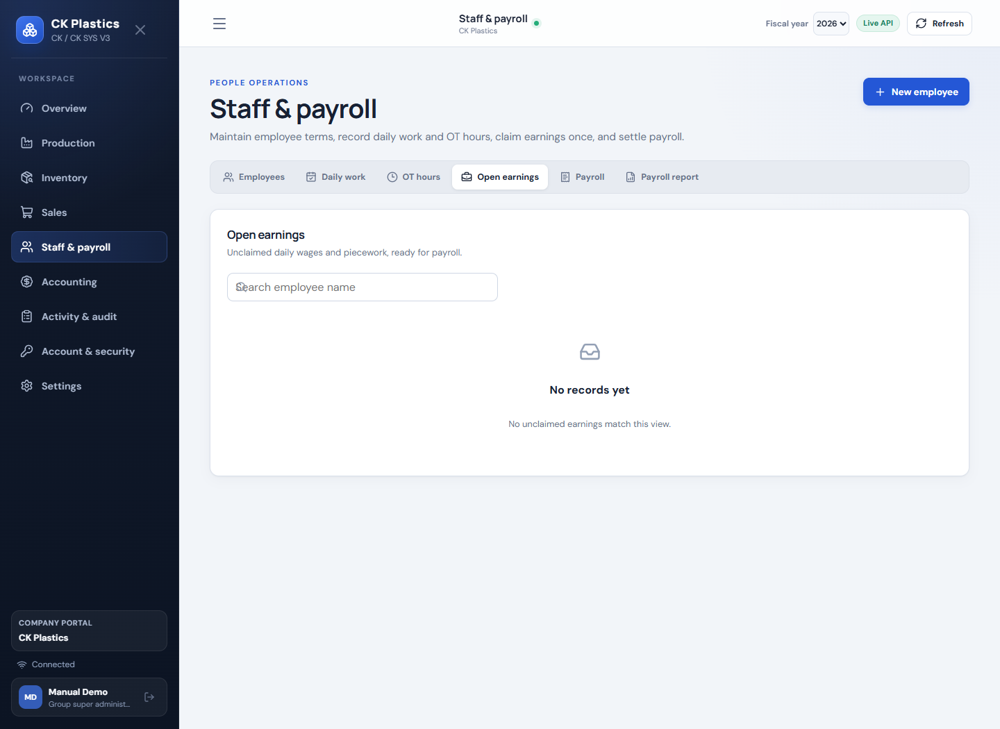

Before payroll:

1. search for the employee;
2. confirm every date, task, quantity/hours, rate, and amount;
3. reverse incorrect source records before claiming them; and
4. ensure no item has already been claimed.

### 11.5 Create payroll

1. Open **Payroll**.
2. Select **Create payroll**.
3. Select the employee.
4. Select the salary month and payroll date.
5. Review the pay model and saved pay terms.
6. Select eligible daily work, conversion earnings, piecework, and overtime.
7. Add any authorized earnings/allowances.
8. Add deductions.
9. Review employer contributions.
10. Verify gross earnings, employee deductions, net pay, and employer cost.
11. Choose **Pay later** or **Pay in full now**.
12. If paying now, select the actual payment method.
13. Post payroll.
14. If payable, post payments only as money is actually transferred.
15. Verify the payroll journal and employee paysheet.

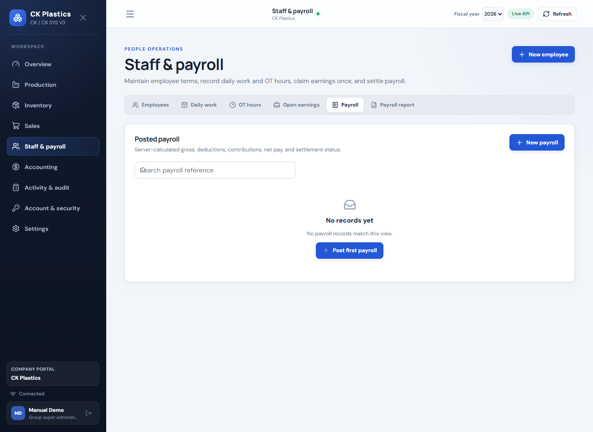

Each eligible earning is claimed once. The server prevents the same work from being settled repeatedly.

### 11.6 Payroll report and paysheet

Use **Payroll report** to select month, search employees, inspect settlement status, and open detailed paysheets. A paysheet can include overview, salary/work, allowances, deductions, employer contributions, payments, and accounting.

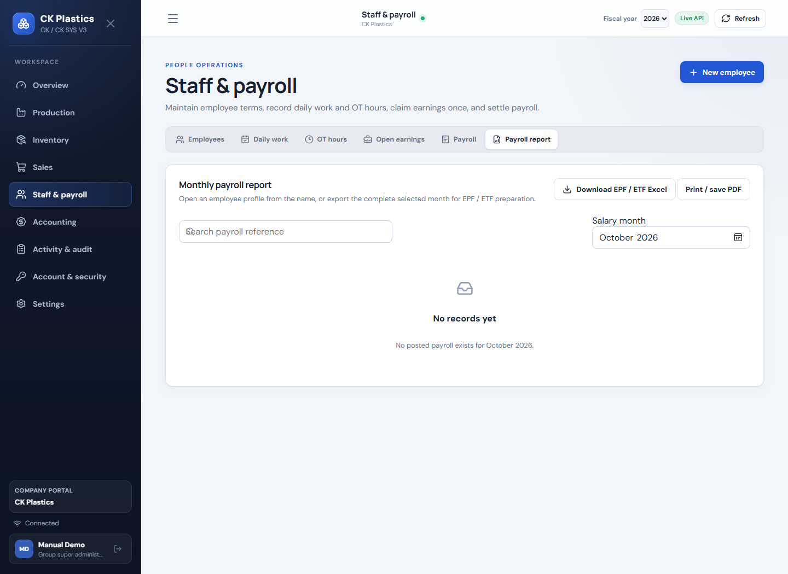

### 11.7 Payroll reversals

- Reversing work/OT retains the original and removes eligible unclaimed earnings.
- Reversing payroll posts offsetting accounting effects and releases claims according to server rules.
- Reversing a payroll payment retains the payment and posts an offset.
- Recheck open earnings and the ledger after every reversal.

---

## 12. Accounting

Open **Accounting**. The tabs are Overview, Quick entry, Journals, Master ledger, Statements, and PDF Studio.

### 12.1 Overview and trial balance

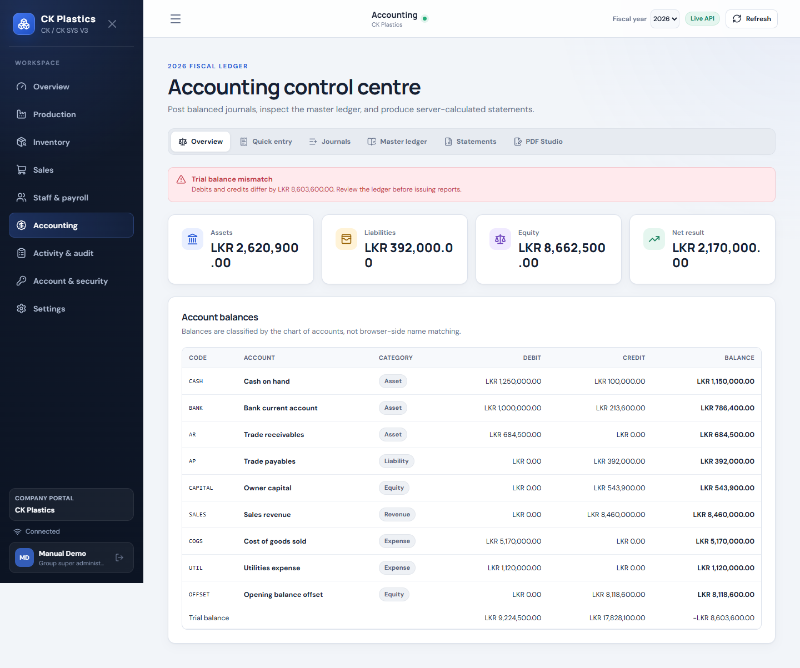

1. Confirm the fiscal year.
2. Select Refresh.
3. Confirm **Trial balance verified**.
4. Review Assets, Liabilities, Equity, and Net result.
5. Review each account's debit, credit, and balance.
6. If a mismatch appears, stop report issuance and investigate the ledger.

### 12.2 Quick double-entry

Use Quick entry only for a real cash/bank movement that does not belong to Sales, Purchasing, Inventory, Payroll, Tax, or Intercompany workflows.

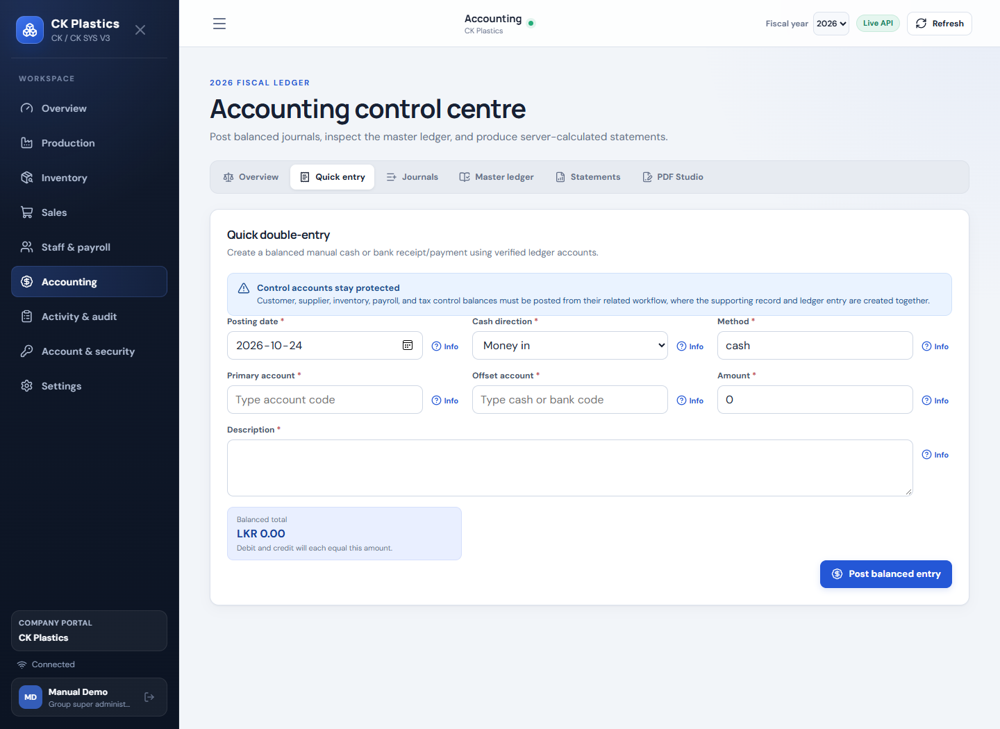

1. Enter the real posting date inside the selected fiscal year and an open period.
2. Select **Money in** or **Money out**.
3. Enter the real method, such as `Bank transfer - BOC`, `Cash`, or `Cheque 001245`.
4. Enter the exact **Primary account** code for the business reason.
5. Enter the exact **Offset account** code where money moved, normally CASH or BANK.
6. Enter a positive amount.
7. Enter a complete description: counterparty, reason, and external reference.
8. Review the debit/credit preview.
9. Post the entry.
10. Verify it in Journals and Master ledger.

Direction logic:

| Direction | Debit | Credit |
|---|---|---|
| Money in | Offset cash/bank asset | Primary revenue, liability, equity, or transfer account |
| Money out | Primary expense, asset, or liability | Offset cash/bank asset |

The system rejects identical accounts, unknown accounts, non-asset money offsets, protected control accounts, zero/negative amounts, closed dates, and unbalanced results.

### 12.3 Advanced journals

Use **Journals → New journal** only when an accountant understands the required debit and credit lines.

1. Enter journal date and memo.
2. Add at least two lines.
3. Select only allowed non-control accounts.
4. Enter either debit or credit on each line, never both.
5. Add line descriptions.
6. Confirm total debits equal total credits to the cent.
7. Select **Post journal**.

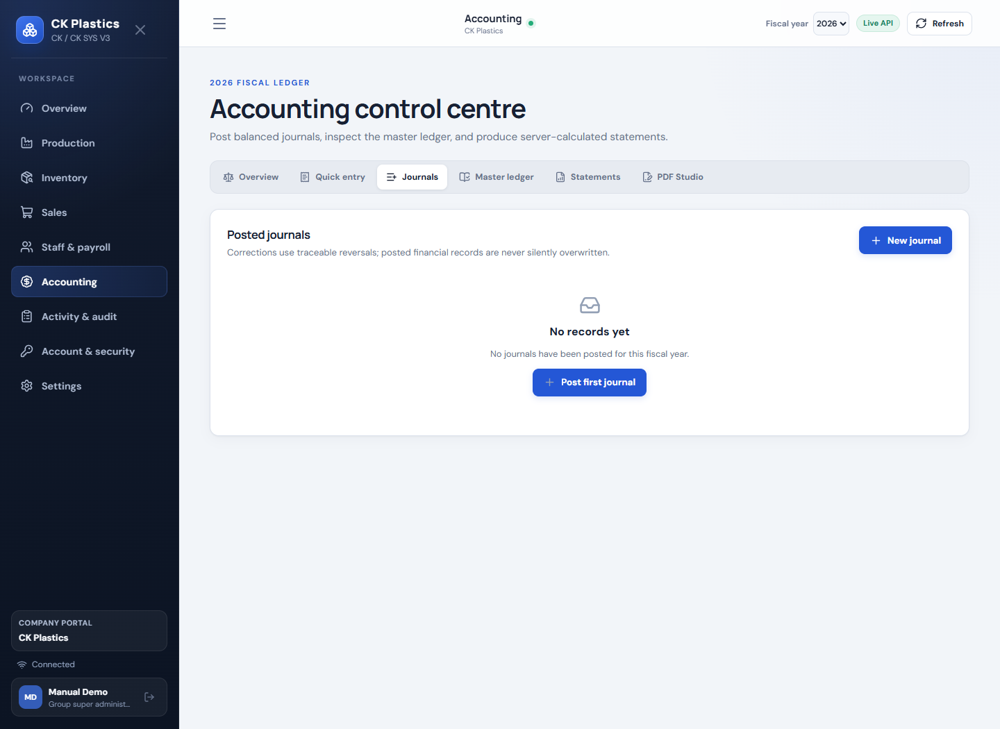

### 12.4 Master ledger

Use the ledger to search posted lines across all modules. Filter by search text, source module, account category, and month.

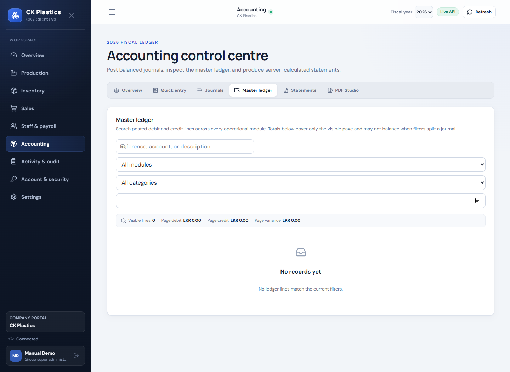

Visible-page totals may not balance if filters split a journal. Reconciliation must use the complete relevant set.

### 12.5 Financial statements

Open **Statements** to obtain the server-calculated financial summary for the selected year. Verify the fiscal year, report generation date, and trial balance before printing or distributing.

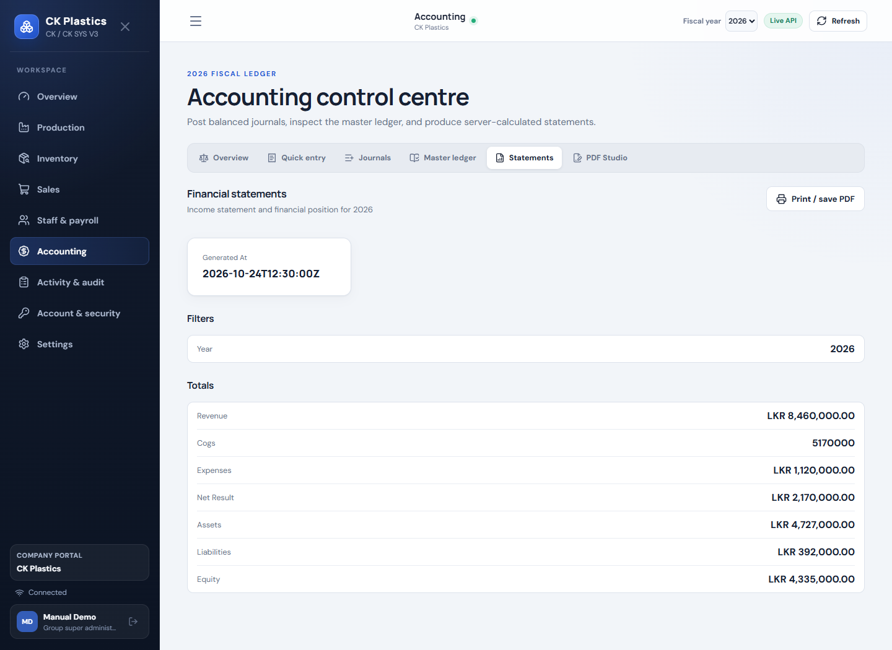

### 12.6 PDF Studio

1. Select **PDF Studio**.
2. Read the restriction notice.
3. Tick the acknowledgement.
4. Select **I understand — open Studio**.
5. Edit export-only values if required for an internal working draft.
6. Use Preview to review the document.
7. Download/save the required output.
8. Exit Studio when complete.

PDF Studio changes are local to the export and are not written to the ledger or database. The output is internal, user-edited, unaudited, and not approved for statutory, tax, regulatory, banking, lending, certification, or other official use.

### 12.7 Journal reversal

Posted journals are corrected by reversal. Select Reverse, confirm the action, and then post the correct entry. The original and offset remain available for audit.

---

## 13. Activity and audit

The **Activity & audit** page is permission-controlled and company-scoped.

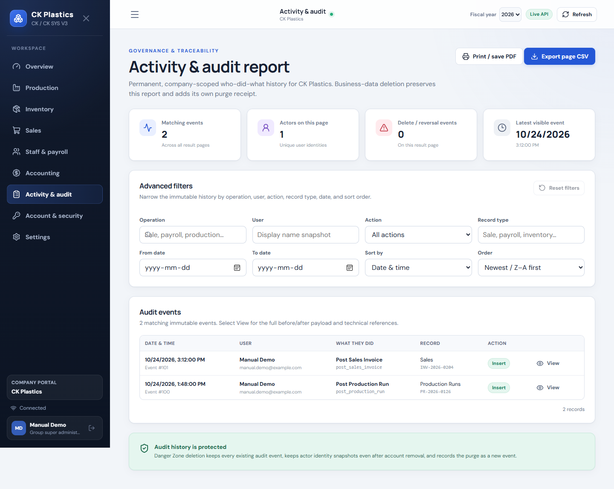

### 13.1 Filter and investigate

1. Open **Activity & audit**.
2. Set date range.
3. Filter by actor/user, action, operation, table/entity, or search terms as available.
4. Select Apply/search.
5. Review date/time, user, action description, record, and action type.
6. Open details to compare before/after data and request identifiers.
7. Use CSV export for controlled analysis.
8. Use Print for a human-readable report.

### 13.2 Audit interpretation

- `insert` means a record was created.
- `update` means a record changed.
- `reverse` means an offsetting correction was posted.
- `delete` may represent controlled deactivation/removal or a destructive operation, depending on entity.
- `execute` represents a controlled procedure/action.

Preserve request IDs when reporting an error; they help correlate browser/API behavior with the audit event.

---

## 14. Account and password security

Every signed-in person can open **Account & security**.

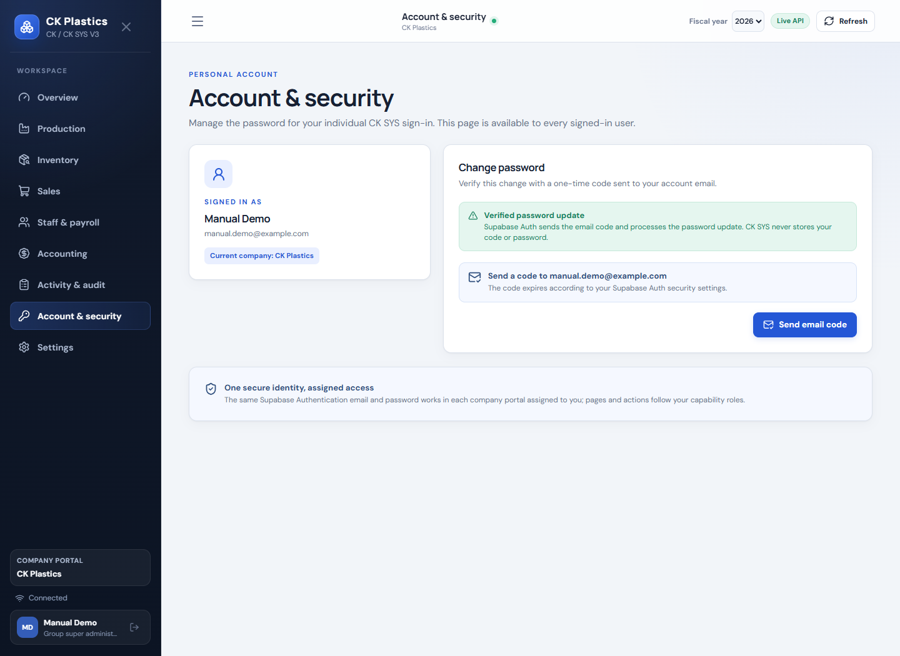

### 14.1 Change a signed-in password

1. Confirm the signed-in identity and current company.
2. Select **Send email code**.
3. Retrieve the 6–10 digit verification code.
4. Enter the code.
5. Enter and confirm a new strong password.
6. Select **Change password**.
7. If the secure session cannot be renewed automatically, sign in manually with the new password.

CK SYS does not store the password or code. Supabase Authentication sends and verifies them.

### 14.2 Account security rules

- Never share passwords or OTP codes.
- Do not store passwords in spreadsheets, chat, or browser notes.
- Change a temporary password at first sign-in.
- Sign out on shared devices.
- Report an unexpected OTP or password-change email immediately.

---

## 15. System settings and administration

Settings requires system-administrator access.

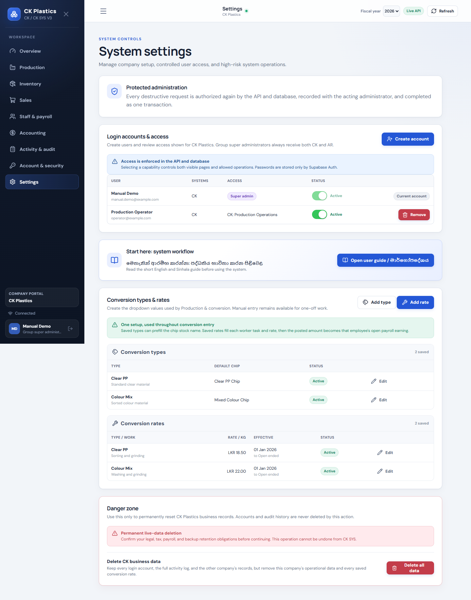

### 15.1 User access administration

- Create accounts with least privilege.
- Review company assignments and packages regularly.
- Toggle Active/Inactive only with authorization.
- Use Remove only when access must stop permanently; a private four-digit confirmation PIN is also required.
- Never remove the only active group super administrator.

### 15.2 Conversion types and rates

- Keep names clear and non-duplicated.
- Use effective dates rather than overwriting history.
- Make old entries inactive or date-limited when replacing them.
- Verify new rates in a controlled conversion before broad use.

### 15.3 Company danger-zone reset

**Delete all data is irreversible in the application.** It applies to the current company and removes that company's operational position plus all shared conversion rates according to the database procedure.

Before using it:

1. obtain owner/management authorization;
2. confirm the company name and code;
3. stop all users from entering transactions;
4. export required financial, inventory, sales, payroll, and audit reports;
5. verify a recoverable database backup outside CK SYS;
6. understand what is deleted, preserved, and external;
7. enter the exact confirmation phrase;
8. tick the irreversible-action acknowledgement; and
9. execute once, then verify the empty/reset company.

The control preserves login accounts, profiles, memberships, capability roles, the activity/audit history, the other company's records, and protected shared master data listed by the dialog. There is no in-app undo.

---

## 16. Corrections and reversals

### 16.1 Choose the correct action

| Situation | Correct approach |
|---|---|
| Draft has not been posted | Correct fields before saving |
| Posted operational record has a supported Correct/Edit action | Use Correct/Edit; the server releases and reposts effects atomically |
| Posted record is invalid/cancelled | Reverse it with a clear reason |
| A valid reversed transaction must be re-entered | Post a new correct transaction |
| Financial journal is wrong | Reverse the journal, then post the correct journal |
| Employee is leaving | Mark/deactivate employee; retain history |
| User access must stop | Set Inactive or Remove through Settings |

### 16.2 After every correction/reversal

1. Refresh the source module.
2. Verify the status.
3. Verify stock impact in Inventory when relevant.
4. Verify balances in Sales/Payroll when relevant.
5. Verify the accounting journal and ledger.
6. Verify the activity event and actor.

---

## 17. Daily, weekly, monthly, and year-end routines

### 17.1 Start of day

1. Sign in to the correct company.
2. Confirm fiscal year and Live API state.
3. Refresh Overview.
4. Review open receivables, payables, workforce obligations, and inventory availability.
5. Confirm conversion rates and employee status for planned work.

### 17.2 During the day

1. Post purchases on the real date with supplier details.
2. Post conversions after measuring input/output and allocating workers.
3. Post production runs after confirming material consumption and output.
4. Check Inventory after every major posting.
5. Post sales invoices only against available finished stock.
6. Record receipts only when received.
7. Record daily work and OT on the correct employee/date.
8. Correct errors promptly through the source workflow.

### 17.3 End of day

1. Refresh Dashboard.
2. Compare production and stock movements with physical records.
3. Review invoices and receipts.
4. Review unusual Activity & audit events.
5. Review Accounting trial balance and cash/bank movements.
6. Resolve warnings or document them for the responsible manager.
7. Sign out.

### 17.4 Payroll cycle

1. Close daily work, conversion allocations, and OT for the period.
2. Review employee terms and open earnings.
3. Create payroll per employee/month.
4. Review additions, deductions, contributions, and net pay.
5. Approve and post payroll.
6. Post actual payments.
7. Reconcile payroll payable, cash/bank, and paysheets.
8. Export the payroll report.

### 17.5 Month-end

1. Complete and verify all operational transactions.
2. Reconcile physical stock to Inventory.
3. Reconcile customer balances and receipts.
4. Reconcile payroll and payments.
5. Review every account balance and the master ledger.
6. Investigate reversals and manual journals in Activity & audit.
7. Export financial, inventory, sales, payroll, and audit reports.
8. Retain exports according to company/legal policy.

### 17.6 Year-end

1. Select the closing fiscal year.
2. Ensure all months are complete.
3. Reconcile stock, receivables, payables, payroll, cash, and bank.
4. Confirm trial balance is balanced.
5. Review manual journals and reversals.
6. Generate statements for review by a qualified accountant.
7. Do not treat PDF Studio drafts as audited/statutory statements.
8. Back up and retain records before beginning the new year.

---

## 18. Validation rules and error recovery

### 18.1 General rules

- Required fields are marked with `*`.
- Quantities, rates, and amounts must normally be positive.
- Searches and lists are server-paged; use search instead of assuming only visible rows exist.
- Dates must match the real event and, for accounting, the selected fiscal year/open period.
- A disabled Save/Post button usually means required information or an acknowledgement is missing.

### 18.2 If Save/Post fails

1. Read the complete error/toast.
2. Do not click repeatedly.
3. Copy the request ID if shown.
4. Correct highlighted fields.
5. Refresh availability/balances if the record depends on live stock or an outstanding amount.
6. Search for the record/reference before retrying; an idempotent request may already have succeeded.
7. Retry once after confirming the current state.
8. If the problem continues, give an administrator the page, company, time, reference, action, error text, and request ID.

### 18.3 Idempotency and duplicate prevention

Write operations send idempotency identifiers. This helps prevent a network retry from creating a second copy. Users must still verify the list before manually re-entering a transaction after an unclear response.

---

## 19. Security and data-handling rules

1. Use an individual identity for each person.
2. Assign least privilege and the minimum companies required.
3. Keep privileged Supabase secret/service keys only in backend deployment secrets; never place them in `VITE_*` variables.
4. Keep public signup disabled unless deliberately required and secured.
5. Review Active/Inactive users regularly.
6. Treat exports as confidential business data.
7. Store backups outside the application and test recovery.
8. Do not use production data in training, demos, or screenshots without authorization.
9. Review the audit report after user-access, reversal, and destructive operations.
10. Keep browsers and operating systems supported and updated.

---

## 20. Troubleshooting

| Problem | Checks and action |
|---|---|
| Login redirects back to sign-in | Confirm email/password, correct company portal, active account, active membership, and network |
| Workspace is missing | The account lacks that capability; ask a super administrator to review access |
| “Offline” or API unreachable | Check network, wait for Live API, select Refresh, and do not post until connected |
| List is empty | Clear search/filters, confirm year/company, refresh, and verify permission |
| Stock is unavailable | Verify company-owned quantity, shared quantity, prior postings, and reversals |
| Saved conversion type/rate missing | Check status/effective date, refresh Settings, or use Manual entry for a one-off transaction |
| Employee missing from selection | Verify employee is Active and belongs to the current company/workflow |
| Work/OT missing from payroll | Confirm date range, employee, status, and whether another payroll already claimed it |
| Receipt/payment rejected | Amount must be positive and not exceed the remaining balance |
| Trial balance mismatch | Stop issuing reports; refresh, inspect ledger/reversals, and escalate to accounting/admin |
| OTP email not received | Check spam, verify email, wait for provider limits, use secure link if supplied, and verify SMTP/template setup |
| Direct link returns hosting 404 | Production must serve SPA fallback for `/ck/*` and `/ar/*` routes |

### 20.1 Information to include in a support report

- company (CK or AR);
- exact page and fiscal year;
- user email (never password);
- date and local time;
- action attempted;
- business reference number;
- complete error text;
- request ID;
- whether Refresh changes the result; and
- screenshot with confidential values redacted if needed.

---

## 21. System verification report

The following checks were performed on 24 October 2026 against the checked-in workspace:

| Check | Scope | Result |
|---|---|---|
| ESLint | Frontend TypeScript/React source | 0 errors; 16 warnings |
| Vitest | Frontend unit/component tests | **Passed:** 18 test files, 53 tests |
| Vitest | Node API contract, validation, security, and frontend tests | **Passed:** run `npm test` for the current total |
| TypeScript + Vite build | Production frontend compilation | **Passed:** 3,092 modules transformed and production assets generated |
| UI route rendering | Portal selection, sign-in/recovery, and authenticated module routes with isolated data | 29 screenshots captured successfully |
| Visual sampling | Dashboard, invoice dialog, and full Settings page | Rendered correctly in headless Microsoft Edge |

The 16 lint warnings are non-blocking. Most report React Compiler memoization opt-outs for React Hook Form's `watch()` API; several are Fast Refresh export warnings; there are also dependency-array warnings in employee workflow effects. They do not fail the build, but they should be reviewed during future maintenance. Vite also reports several generated chunks above 500 kB; this is a performance/optimization warning rather than a correctness failure.

### 21.1 Verification boundary

Automated tests and isolated UI rendering can verify code paths, validation, contracts, and presentation. They do **not** prove the following external production conditions without authorized live credentials and infrastructure access:

- hosted Supabase migrations exactly match the repository;
- production RLS/policies and role grants are deployed exactly as intended;
- SMTP sends OTP/recovery email end to end;
- production secrets, trusted hosts, DNS, TLS, backups, and monitoring are correct;
- real CK/AR opening balances and physical inventory reconcile; or
- every browser/device/printer combination behaves identically.

Before go-live, an authorized administrator should complete the production acceptance checklist in the next section using non-destructive sample transactions and then reverse them.

---

## 22. Quick-reference checklists

### 22.1 Go-live acceptance checklist

- [ ] Production URL and direct `/ck/login` and `/ar/login` links load.
- [ ] `/api/v1/health/live` succeeds.
- [ ] Public signup is disabled.
- [ ] All migrations are applied in order.
- [ ] Database verification scripts pass in a non-production/staging project.
- [ ] Backend and frontend use the same Supabase project.
- [ ] No secret/service key is exposed in frontend variables or browser code.
- [ ] Super administrators can access both companies.
- [ ] Restricted users see only assigned workspaces.
- [ ] Inactive users are denied.
- [ ] Purchase test changes bulk stock and accounting together.
- [ ] Conversion test changes bulk/chip stock and creates worker earnings.
- [ ] Production test changes chip/finished stock and costing.
- [ ] Sales test changes finished stock, revenue, COGS, and customer balance.
- [ ] Receipt test reduces the customer balance and posts cash/bank.
- [ ] Work/OT test appears once in open earnings and one payroll.
- [ ] Payroll and payment tests post and reconcile.
- [ ] Trial balance is balanced.
- [ ] Reversals retain history and offset effects.
- [ ] Audit export identifies the correct actor/action/company.
- [ ] OTP/recovery and signed-in password change work through production SMTP.
- [ ] Reports print/save as PDF.
- [ ] Backup restoration has been tested.

### 22.2 Purchase checklist

- [ ] Correct company and date
- [ ] Supplier/reference recorded
- [ ] Material and kg verified
- [ ] Total cost verified
- [ ] Actual payment method selected
- [ ] Bulk inventory verified
- [ ] Accounting entry verified

### 22.3 Conversion checklist

- [ ] Correct source bulk item
- [ ] Input measured
- [ ] Output measured and within tolerance
- [ ] Chip name/type correct
- [ ] Every worker selected
- [ ] Task, kg, and rate approved
- [ ] Bulk/chip inventory verified
- [ ] Open earnings verified

### 22.4 Production checklist

- [ ] Operator, machine, shift, and date correct
- [ ] Correct chip input and available quantity
- [ ] Existing/new product chosen correctly
- [ ] Selling price approved
- [ ] Output and overhead verified
- [ ] Finished inventory and unit cost verified

### 22.5 Sales checklist

- [ ] Unique invoice number
- [ ] Correct customer and phone
- [ ] Available product selected
- [ ] Quantity, price, and discount approved
- [ ] Initial receipt equals money actually received
- [ ] Balance/status verified
- [ ] Inventory, COGS, revenue, and receivable verified

### 22.6 Payroll checklist

- [ ] Employee and month correct
- [ ] Pay terms effective and approved
- [ ] Work, conversion earnings, and OT reviewed
- [ ] Additions/deductions authorized
- [ ] Employer contributions reviewed
- [ ] Gross, net, and employer cost verified
- [ ] Payment status/method matches reality
- [ ] Paysheet and journal verified

---

## 23. Glossary

| Term | Meaning |
|---|---|
| Bulk | Purchased/raw material before conversion |
| Chip | Converted material used as production input |
| Finished product | Saleable output produced from chip stock |
| Company quantity | Stock owned/allocated to the current company |
| Shared warehouse quantity | Physical availability visible across permitted company inventory |
| Weighted average cost | Inventory cost recalculated from stock movements and quantities |
| COGS | Cost of goods sold recognized when finished stock is sold |
| Open earning | Employee work amount not yet claimed by payroll |
| Payroll claim | Link that settles eligible work/OT exactly once in payroll |
| Journal | Balanced collection of debit and credit lines |
| Control account | Account updated by its operational workflow, not ordinary manual posting |
| Reversal | Traceable offset that removes the effect while preserving the original |
| Idempotency key | Request identifier used to reduce duplicate posting during retries |
| RLS | PostgreSQL row-level security enforcing which rows a user can access |
| OTP | One-time password/code used for recovery or password verification |

---

**End of manual**

